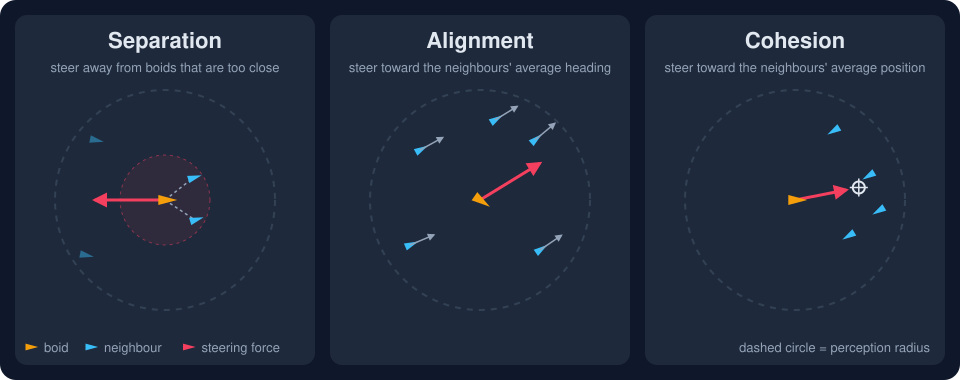
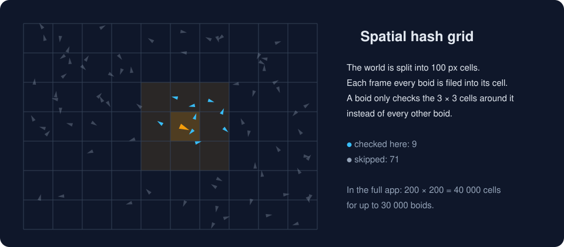

<div align="center">

# FlockSim

### A petri dish for boids.

Seed 3 000 identical birds into a 20 000 px world, scatter food, and let natural selection decide what a good flock looks like.


<sub>Illustration made with a small boids simulation in Python, not a screenshot of the app.</sub>

<p>


</p>

[The genome](#the-genome) · [Life in the dish](#life-in-the-dish) · [Experiments](#experiments-to-try) · [Controls](#controls) · [Build](#build-and-run) · [Under the hood](#under-the-hood)

</div>

---

Most boids demos stop at Craig Reynolds' three rules. In FlockSim the rules are only the body: every boid also carries a **genome** that decides *how strongly* it follows them. Boids that find food, live long enough and meet a mate pass a slightly mutated copy of their genes to a child. Nobody designs the flock; it drifts, generation by generation, toward whatever survives.

All 3 000 starters share the same genes, so they all start the same purple. The colour of every child is computed from its genes, which turns the screen into a live map of the gene pool: when new colours spread, a new strategy is winning.

## The genome

Each boid has eight heritable genes. At every birth each gene moves by a random step and is clamped to its range (constants in [`Boid.hpp`](includes/classes/Boid.hpp), mutation in `Boid::tweakstats`).

| Gene | Starts at | Step per birth | Range | What it controls |
|---|---:|---:|---:|---|
| `perception` | 50 | ± 20 | 0 – 200 | How far the boid can see its neighbours |
| `max_steer` | 0.06 | ± 0.005 | 0 – 0.1 | How hard it turns to match their heading (alignment) |
| `max_cohesion` | 0.035 | ± 0.005 | 0 – 0.1 | How hard it pulls toward the group's centre |
| `max_separation` | 0.5 | ± 0.05 | 0 – 1.0 | How hard it pushes away from boids that are too close |
| `separation_ratio` | 0.35 | ± 0.05 | 0 – 1.0 | How close is "too close" |
| `obstacle_avoidance` | 0.1 | ± 0.005 | 0 – 0.1 | How hard it steers away from the world edge |
| `apetite` | 0.1 | ± 0.05 ¹ | 0 – 0 ² | How hard it steers toward food it can smell |
| `max_speed_food` | 2 | ± 0.5 ¹ | 0 – 7.5 | Top speed when chasing food |

<sub>¹ Only mutates for boids with **Smells Food** switched on (off by default; toggle it in a boid's stats window).
² `MAX_APETITE` is currently `0.0f`, so every child's appetite is clamped to 0. Raise it in `Boid.hpp` to let food-seeking evolve.</sub>

### Reading the colours

| Channel | Comes from | So… |
|---|---|---|
| 🔴 Red | low `max_steer` | red boids care little about matching their neighbours' heading |
| 🟢 Green | `perception` | brighter green boids see further |
| 🔵 Blue | high `max_steer` | blue boids align strongly and fly in tight formation |

The starting genes give `rgb(102, 63, 153)`, a dull purple. Anything else on screen is a mutant.

## Life in the dish



Every frame, each boid looks at the neighbours inside its `perception` radius and adds up three steering forces, each scaled by its own genes: **separation**, **alignment** and **cohesion**. Border avoidance and food are added on top, and the speed is kept between `min_speed` and `max_speed`.


At `GameSpeed` 1, one in-game year is 15 real seconds, so:

| Milestone | In-game | Real time |
|---|---:|---:|
| Old enough to breed | age 20 | 5 min |
| Dies of old age | age 90 | 22.5 min |

- Eaten **food** is stored and slowly turned into **energy** (up to 2 000).
- Out of energy, a boid loses **health** until it dies.
- With more than **1 000 energy** and age over 20, touching another living boid produces a child. The parent pays 1 000 energy for it.
- With **Food on Death** on, every corpse becomes food for the next generation.
- The world holds at most **30 000** boids; when every slot is taken, nobody can breed until someone dies.

## Experiments to try

FlockSim is most fun as a sandbox. A few questions worth answering yourself:

- **Which genes win?** Leave it running at a high `GameSpeed` and watch which colour takes over. Does it change if food only spawns in a small circle?
- **No alignment.** Untick **Align** in Engine Options. Do flocks still form from cohesion alone?
- **Famine.** Turn off **Food on Death** and shrink the spawn area. How low does the population fall before it recovers, if it does?
- **Hunters.** Raise `MAX_APETITE` in `Boid.hpp`, rebuild, and switch on **Smells Food** for one boid. Do its descendants outcompete the rest?
- **Crowding.** Raise **Separation Ratio** for everyone. Are loose flocks better or worse at finding food?
- **Step through it.** Press `Space` to pause and `→` to advance one step at a time, with **Draw Forces** on, to see each force on each boid.

## Controls

| Camera | | Boids | |
|---|---|---|---|
| `W` `A` `S` `D` | move | `LMB` on a boid | follow it and open its stats |
| Mouse wheel | zoom | `F` | stop following |
| `Shift` + mouse | pan toward the cursor | `RMB` | spawn a boid at the cursor |
| `Q` / `E` | rotate | `Space` | pause / resume |
| `R` | reset rotation | `→` (paused) | advance one step |

Everything else (flocking weights, speeds, food spawning, debug overlays) is live in the Dear ImGui panel.

## Build and run

```bash
git clone https://github.com/gecarval/FlockSim.git
cd FlockSim
make -j"$(nproc)"     # raylib and Dear ImGui are bundled
./flocksim
```

Needs `g++`, `make` and a Linux desktop with OpenGL (X11, or Wayland through XWayland). `make debug` runs it under Valgrind with `valgrind.supp`.

## Under the hood



Comparing every boid with every other one would take about 900 million checks per frame at 30 000 boids. Instead the world is cut into **100 px cells** (`HASH_QUAD_SIZE`), 200 × 200 = 40 000 of them. Each frame every boid and food item is filed into its cell, and a boid only reads the cells around it.

```
srcs/
├── main.cpp                  window, camera, main loop
├── update.cpp · input.cpp    simulation step, controls
├── menu.cpp                  Dear ImGui panels
└── classes/
    ├── Boid.cpp              steering, life cycle, breeding, mutation
    ├── Flock.cpp             flock update, food, drawing
    └── SpatialHashing.cpp    the grid
includes/                     headers + constants, bundled raylib / ImGui
docs/                         README diagrams (python3 docs/make_diagrams.py docs)
```

## Further reading

- Craig Reynolds, [*Flocks, Herds, and Schools: A Distributed Behavioral Model*](https://www.red3d.com/cwr/papers/1987/boids.html) (SIGGRAPH 1987) and [*Boids*](https://www.red3d.com/cwr/boids/)
- Daniel Shiffman, [*The Nature of Code*: Autonomous Agents](https://natureofcode.com/autonomous-agents/)
- Built with [raylib](https://www.raylib.com/), [Dear ImGui](https://github.com/ocornut/imgui), [rlImGui](https://github.com/raylib-extras/rlImGui) and [Font Awesome](https://fontawesome.com/) (see `includes/extras/FontAwsome_LICENSE.txt`)

---

<div align="center">

Released under the [MIT License](./LICENSE) · Made by [Gerson Carvalho](https://github.com/gecarval) at 42

</div>
