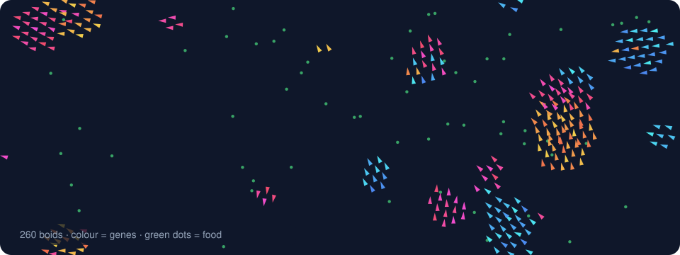
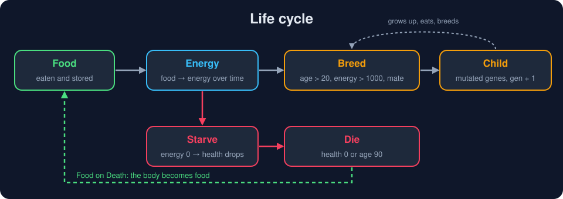

<div align="center">

# 🐦 FlockSim

**A flocking and evolution simulator in C++. Thousands of boids swarm, eat, breed and mutate in real time.**

<p>


</p>



<sub>Illustration made with a small boids simulation in Python, not a screenshot of the app.</sub>

[Quick start](#-quick-start) · [Features](#-features) · [Controls](#-controls) · [How it works](#-how-it-works) · [Tuning](#-tuning)

</div>

---

## ✨ What it is

FlockSim starts from Craig Reynolds' classic **boids** model and adds a **life cycle**. Every boid follows three local rules: separation, alignment and cohesion. It also has to find food to stay alive, and when it is old enough and well fed it breeds with a nearby mate. Each child inherits its parent's genes with small random mutations, so over many generations the flock's behaviour **evolves**. You can see the change as the boids' colours shift.

Everything runs live in a 20 000 × 20 000 world with up to **30 000 boids**. A spatial hash grid keeps the neighbour lookups fast.

## 🚀 Quick start

```bash
git clone https://github.com/gecarval/FlockSim.git
cd FlockSim
make -j"$(nproc)"     # raylib and Dear ImGui are bundled
./flocksim
```

> **Requirements:** `g++`, `make`, and a Linux desktop with OpenGL (X11, or Wayland through XWayland).
> Other targets: `make run`, `make re`, `make clean`, `make debug` (runs under Valgrind with `valgrind.supp`).

## 🧩 Features

| | Feature | Details |
|---|---|---|
| 🐦 | **Boids flocking** | Separation, alignment and cohesion, each with its own strength and radius |
| 🧬 | **Evolution** | Children inherit and mutate perception, steering, cohesion, separation, obstacle avoidance and food-seeking genes |
| 🎨 | **Colour shows genes** | A boid's colour comes from its genes, so you can watch lineages spread |
| 🍖 | **Food and life cycle** | Boids have health, energy, age and stored food. They starve, age (max age 90) and can leave food behind when they die |
| 💞 | **Breeding** | A boid older than 20 with more than 1000 energy breeds when it meets a mate |
| ⚡ | **Spatial hashing** | A 200 × 200 grid of 100 px cells, so each boid only checks nearby cells |
| 🧱 | **World edges** | Wrap around the edges (mirror), or have boids steer away from the border |
| 🔍 | **Inspect any boid** | Click a boid to follow it with the camera and see all its stats live |
| 🎛️ | **Live tuning** | Change every flocking weight, the game speed, food spawning and the debug overlays in Dear ImGui |
| 🐞 | **Debug views** | Draw perception radii, force vectors, food, spawn zones and the hash grid |

## 🎮 Controls

| Input | Action |
|---|---|
| `W` `A` `S` `D` | Move the camera |
| Mouse wheel | Zoom in and out |
| `Shift` + mouse | Pan toward the cursor |
| `Q` / `E` | Rotate the camera |
| `R` | Reset the rotation |
| `LMB` on a boid | Follow it and show its stats |
| `F` | Stop following |
| `RMB` | Spawn a boid at the cursor |
| `Space` | Pause or resume |
| `→` (while paused) | Advance one step |

## 🧠 How it works


<details>
<summary><b>Flocking rules</b></summary>

Each frame, every boid looks at the boids within its **perception** radius:

| Rule | Steers toward | Gene |
|---|---|---|
| **Separation** | Away from neighbours that are closer than `radius × separation_ratio` | `max_separation`, `separation_ratio` |
| **Alignment** | The average heading of its neighbours | `max_steer` |
| **Cohesion** | The average position of its neighbours | `max_cohesion` |
| **Border avoidance** | Away from the world edge | `obstacle_avoidance` |

The forces add up to an acceleration. Velocity is then limited to the range `[min_speed, max_speed]` and scaled by `GameSpeed`.
</details>

<details>
<summary><b>Life, food and death</b></summary>



- Stored **food** turns into **energy** over time.
- With no energy left, a boid loses **health** each tick until it dies.
- A boid also dies of old age after **90** (in-game) years.
- With **Food on Death** enabled, a dead boid leaves food where it died.
- New food appears over time inside a rectangle or circle you choose, or where boids collide.
</details>

<details>
<summary><b>Breeding and mutation</b></summary>

A boid can breed when its **age > 20**, its **energy > 1000**, and it overlaps another living boid (its mate). The child takes a free slot and gets:

- full health, the minimum breeding energy, age 0 and **generation + 1**;
- each gene from the parent, plus a small random change (`MUTATION_RATE = 5`), limited to that gene's maximum;
- a colour computed from those genes.

Because only boids that live long enough and eat enough get to breed, the gene pool drifts toward whatever works in the current environment.
</details>

<details>
<summary><b>Spatial hashing</b></summary>

Comparing every boid with every other one would cost O(n²), which is about 900 million checks per frame at 30 000 boids. Instead, the world is split into **100 px cells** (`HASH_QUAD_SIZE`), so the 20 000 × 20 000 world has 40 000 cells. Each frame, every boid is filed into its cell. When a boid looks for neighbours it only reads the cells around it, which keeps the cost close to linear.


</details>

## 🎛️ Tuning

The ImGui panel controls:

- **Flocking:** min and max speed, perception, alignment, cohesion, separation, separation ratio, obstacle avoidance, the alignment algorithm, and `GameSpeed`
- **Engine:** turn mirror, avoid border, align, cohese, separate and food on death on or off; limit the frame rate; randomise boid positions
- **Food spawn:** draw the spawn zone, spawn food on collision, choose a rectangle or circle zone
- **Display:** FPS, boids, perception radii, forces, food, the hash grid

Compile-time constants (world size, boid cap, life thresholds, mutation limits) are in [`includes/classes/Boid.hpp`](includes/classes/Boid.hpp) and [`includes/classes/SpatialHashing.hpp`](includes/classes/SpatialHashing.hpp).

## 🗂️ Project structure

```
FlockSim/
├── srcs/
│   ├── main.cpp            # window, camera, main loop
│   ├── update.cpp          # simulation step
│   ├── input.cpp           # camera, focus, spawn, pause
│   ├── menu.cpp            # Dear ImGui panels
│   └── classes/
│       ├── Boid.cpp        # steering, life cycle, breeding, mutation
│       ├── Flock.cpp       # flock update, food, drawing
│       └── SpatialHashing.cpp
├── includes/               # headers, constants, bundled raylib + ImGui
├── imgui*.cpp, rlImGui.cpp # Dear ImGui + raylib backend
└── Makefile
```

## 📚 References

- Craig Reynolds, [*Flocks, Herds, and Schools: A Distributed Behavioral Model*](https://www.red3d.com/cwr/papers/1987/boids.html) (SIGGRAPH 1987)
- Craig Reynolds, [*Boids*](https://www.red3d.com/cwr/boids/)
- Daniel Shiffman, [*The Nature of Code*: Autonomous Agents](https://natureofcode.com/autonomous-agents/)
- [raylib](https://www.raylib.com/) · [Dear ImGui](https://github.com/ocornut/imgui) · [rlImGui](https://github.com/raylib-extras/rlImGui) · [Font Awesome](https://fontawesome.com/) (see `includes/extras/FontAwsome_LICENSE.txt`)

---

<div align="center">

Released under the [MIT License](./LICENSE) · Made by [Gerson Carvalho](https://github.com/gecarval) at 42

</div>
